


**Founder & CEO · Systems Engineer · Open-source Builder**

[Personal site](https://eshan.tonmoyinfrastructure.org/) · [Company](https://tonmoyinfrastructure.org/) · [LinkedIn](https://www.linkedin.com/in/eshanized/) · [GitLab](https://gitlab.com/SnigdhaOS)

---

## About

I'm **Eshan Roy**, Founder & CEO of **[Tonmoy Infrastructure & Vision](https://tonmoyinfrastructure.org)**. I turn ambitious engineering ideas into dependable software, working across autonomous AI, Linux ecosystems, developer tooling, and infrastructure.

<table>
<tr>
<td width="33%" valign="top">

**01 / THINK IN SYSTEMS**

I start with first principles: clear architecture, explicit boundaries, and an understanding of how components behave together.

</td>
<td width="34%" valign="top">

**02 / BUILD THE FOUNDATIONS**

I work close to the runtime, tools, platforms, and infrastructure that make ambitious products practical.

</td>
<td width="33%" valign="top">

**03 / SHIP WITH INTENT**

I value secure defaults, predictable behavior, useful diagnostics, and experiences that respect the people using them.

</td>
</tr>
</table>

My north star: make complex engineering feel clear, capable, and dependable.

## The engineering map

## Selected work

<table>
<tr>
<td width="50%" valign="top">

**[M31A — Autonomous software engineering](https://github.com/eshanized/M31A)**

An open-source engineering agent focused on repository understanding, planning, governed tool execution, and verifiable development workflows.

[Repository](https://github.com/eshanized/M31A) · [Product](https://m31a.tonmoyinfrastructure.org/) · [Docs](https://docs.m31a.tonmoyinfrastructure.org/)
</td>
<td width="50%" valign="top">
<a href="https://gitlab.com/SnigdhaOS"></a>

**[Snigdha OS — Linux ecosystem](https://gitlab.com/SnigdhaOS)**

An independent Arch-based operating-system ecosystem spanning desktop experiences, system applications, packaging, and developer-first workflows.

[GitLab group](https://gitlab.com/SnigdhaOS) · [Decentralize](https://gitlab.com/SnigdhaOS/decentralize)
</td>
</tr>
<tr>
<td width="50%" valign="top">

**[Kyro — Desktop AI workspace](https://github.com/eshanized/Kyro)**

Exploring agent-driven desktop workflows, browser interaction, automation, and user-controlled execution.

[Repository](https://github.com/eshanized/Kyro) · [Product](https://kyro.tonmoyinfrastructure.org/)
</td>
<td width="50%" valign="top">

**[Octate — Terminal-native code review](https://github.com/eshanized/Octate)**

Developer tooling that brings repository analysis and code-review workflows closer to the command line.

[Repository](https://github.com/eshanized/Octate)
</td>
</tr>
</table>

### More from the lab

A collection of experiments and products exploring the edges of software, infrastructure, and developer experience.

<table>
<tr>
<td width="50%" valign="top">

<a href="https://github.com/eshanized/OpenMail"></a>

**[OpenMail](https://github.com/eshanized/OpenMail)**

Privacy-conscious webmail designed to work with existing mail infrastructure. A self-hosting-oriented approach to organizational email.

MAIL · PRIVACY · IMAP / SMTP

</td>
<td width="50%" valign="top">

<a href="https://github.com/eshanized/SLMGen"></a>

**[SLMGen](https://github.com/eshanized/SLMGen)**

Tooling for small-language-model experimentation and dataset workflows, from preparing source data to building useful model pipelines.

AI · DATASETS · MODEL TOOLING

</td>
</tr>
<tr>
<td width="50%" valign="top">

<a href="https://github.com/eshanized/Runstead"></a>

**[Runstead](https://github.com/eshanized/Runstead)**

A hosting-business management platform exploring the workflows behind customers, services, billing, and infrastructure operations.

HOSTING · OPERATIONS · PLATFORM

</td>
<td width="50%" valign="top">

<a href="https://github.com/eshanized/CutePanda"></a>

**[CutePanda](https://github.com/eshanized/CutePanda)**

A lightweight browser exploration focused on a clean, approachable browsing experience without unnecessary complexity.

BROWSER · DESKTOP · USER EXPERIENCE

</td>
</tr>
<tr>
<td colspan="2" valign="top">

<a href="https://github.com/eshanized/MCP-SuperAssistant"></a>

**[MCP-SuperAssistant](https://github.com/eshanized/MCP-SuperAssistant)**

Exploring the Model Context Protocol ecosystem and assistant tooling: connecting AI applications with external capabilities through structured tool interfaces.

MCP · AI INTEGRATIONS · TOOL ECOSYSTEM

</td>
</tr>
</table>

Each project is evolving independently. Visit its repository for implementation details, current capabilities, and contribution opportunities.

## Technology

**Programming languages**


**Platforms & systems**

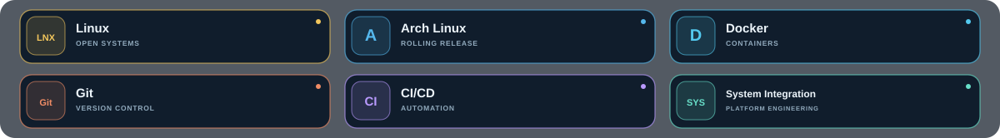

**Application engineering**

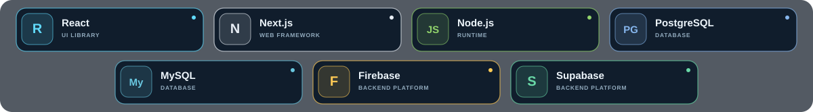

## Engineering telemetry


**CONTRIBUTION MAP · THE LAST 12 MONTHS**

<table>
<tr>
<td width="50%" valign="top">

</td>
<td width="50%" valign="top">

</td>
</tr>
</table>

**COMMIT PULSE · CONTRIBUTION HISTORY**

Charts are generated from public GitHub activity. External chart services may cache results before refreshing.

## How I build

**Architecture with intent.** Clear boundaries, explicit contracts, and systems that can evolve.

**Security by design.** Least privilege, explicit trust boundaries, and safe defaults.

**Evidence over hype.** Reproducible tests, observable behavior, and honest project status.

**Reliability is a feature.** Cancellation, recovery paths, diagnostics, and predictable failure modes.

**Open by default.** Useful documentation, reviewable changes, and constructive collaboration.

---

**Building systems with purpose. Shipping tools in the open.**

[Website](https://eshan.tonmoyinfrastructure.org/) · [Company](https://tonmoyinfrastructure.org/) · [GitHub](https://github.com/eshanized)

Made with curiosity, engineering discipline, and an open-source mindset.

