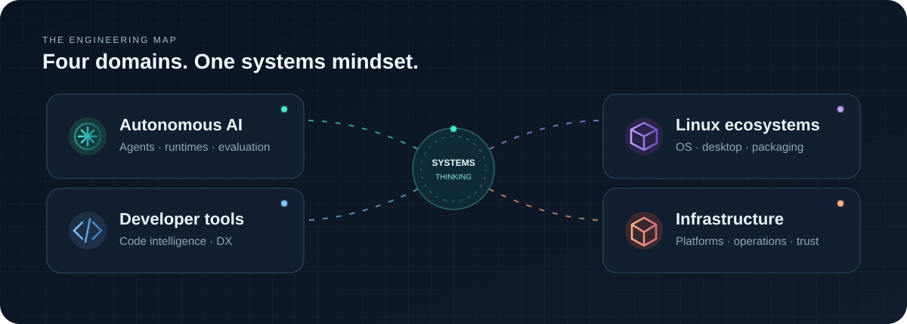

**Founder & CEO · Systems Engineer · Open-source Builder**

[Personal site](https://eshan.tonmoyinfrastructure.org/) · [Company](https://tonmoyinfrastructure.org/) · [LinkedIn](https://www.linkedin.com/in/eshanized/) · [GitLab](https://gitlab.com/SnigdhaOS)

---

## About

I'm **Eshan Roy**, founder of **[Tonmoy Infrastructure & Vision](https://tonmoyinfrastructure.org)**. I work across systems engineering, autonomous software engineering, Linux ecosystems, developer tooling, and infrastructure products.

I like building from first principles: clear architecture, explicit trust boundaries, predictable runtime behavior, useful diagnostics, and a product experience that respects its users.

My goal is to turn ambitious engineering ideas into software that is dependable, understandable, and genuinely useful.

## The engineering map

## Selected work

<table>
<tr>
<td width="50%" valign="top">

**[M31A — Autonomous software engineering](https://github.com/eshanized/M31A)**

An open-source engineering agent focused on repository understanding, planning, governed tool execution, and verifiable development workflows.

[Repository](https://github.com/eshanized/M31A) · [Product](https://m31a.tonmoyinfrastructure.org/) · [Docs](https://docs.m31a.tonmoyinfrastructure.org/)
</td>
<td width="50%" valign="top">

**[Snigdha OS — Linux ecosystem](https://gitlab.com/SnigdhaOS)**

An independent Arch-based operating-system ecosystem spanning desktop experiences, system applications, packaging, and developer-first workflows.

[GitLab group](https://gitlab.com/SnigdhaOS) · [Decentralize](https://gitlab.com/SnigdhaOS/decentralize)
</td>
</tr>
<tr>
<td width="50%" valign="top">

**[Kyro — Desktop AI workspace](https://github.com/eshanized/Kyro)**

Exploring agent-driven desktop workflows, browser interaction, automation, and user-controlled execution.

[Repository](https://github.com/eshanized/Kyro) · [Product](https://kyro.tonmoyinfrastructure.org/)
</td>
<td width="50%" valign="top">

**[Octate — Terminal-native code review](https://github.com/eshanized/Octate)**

Developer tooling that brings repository analysis and code-review workflows closer to the command line.

[Repository](https://github.com/eshanized/Octate)
</td>
</tr>
</table>

### More from the lab

| Project | Focus |
|:--|:--|
| [OpenMail](https://github.com/eshanized/OpenMail) | Privacy-conscious webmail for existing mail infrastructure |
| [SLMGen](https://github.com/eshanized/SLMGen) | Small-language-model and dataset workflows |
| [Runstead](https://github.com/eshanized/Runstead) | Hosting-business and service-management platform |
| [CutePanda](https://github.com/eshanized/CutePanda) | Lightweight browser exploration |
| [MCP-SuperAssistant](https://github.com/eshanized/MCP-SuperAssistant) | MCP ecosystem and assistant tooling |

## Technology

**Languages**  
Rust · Go · Python · TypeScript · JavaScript · Bash

**Platforms & systems**  
Linux · Arch Linux · Docker · Git · CI/CD · system integration

**Application engineering**  
React · Next.js · Node.js · PostgreSQL · MySQL · Firebase · Supabase

## GitHub activity

## How I build

**Architecture with intent.** Clear boundaries, explicit contracts, and systems that can evolve.

**Security by design.** Least privilege, explicit trust boundaries, and safe defaults.

**Evidence over hype.** Reproducible tests, observable behavior, and honest project status.

**Reliability is a feature.** Cancellation, recovery paths, diagnostics, and predictable failure modes.

**Open by default.** Useful documentation, reviewable changes, and constructive collaboration.

---

**Building systems with purpose. Shipping tools in the open.**

[Website](https://eshan.tonmoyinfrastructure.org/) · [Company](https://tonmoyinfrastructure.org/) · [GitHub](https://github.com/eshanized)

Made with curiosity, engineering discipline, and an open-source mindset.

